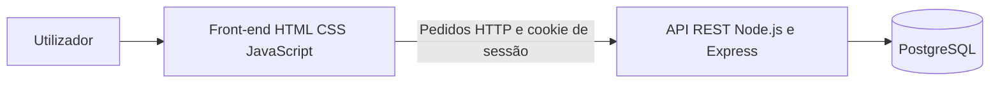

# 🐸 WaterKraft

**WaterKraft** é uma aplicação web de acompanhamento da hidratação. O utilizador pode registar o consumo de água, definir uma meta diária e acompanhar o seu progresso. Este projeto académico demonstra uma aplicação full-stack com interface web, API REST, autenticação e base de dados PostgreSQL.

## Funcionalidades implementadas

### Hidratação e progresso

- Registo e consulta do histórico de consumo de água.
- Meta diária personalizável e avaliação inicial.
- Estatísticas dos últimos sete dias e calendário mensal de hidratação.
- Perfil com sequência de dias, recordes e selos de progresso.
- Tarot da Hidratação com tiragem de três cartas, significados e cartas invertidas.

### Conta e segurança

- Registo, início e término de sessão.
- Palavras-passe guardadas com hash bcrypt.
- Sessões autenticadas por cookie `HttpOnly`, com sessão persistida e revogação no logout.
- Registos de água isolados por utilizador autenticado.
- Cabeçalhos de segurança, validação da origem dos pedidos e limitação de tentativas de login por IP e conta.

### Interface

- Front-end responsivo feito com HTML, CSS e JavaScript.
- Páginas de login e registo, painel de hidratação, avaliação inicial, configurações e sessão expirada.

### Desafios

- Gestores podem criar, editar e apagar os seus desafios.
- Utilizadores podem participar em vários desafios e sair quando quiserem.
- Participações guardadas numa tabela de ligação com prevenção de duplicados na base de dados.
- [Diagrama entidade-relacionamento](docs/diagrama-er.md).

### Manutenção

- Limpeza diária de contadores de tentativas de login inativos há mais de 24 horas, com registo de execuções e erros no log. A tarefa não altera contas nem registos de hidratação.

## Arquitetura

O projeto separa a interface, a API e a base de dados em três serviços. Em desenvolvimento, o Docker Compose inicia os serviços e aplica migrações e dados fictícios.



- **Front-end:** ficheiros estáticos servidos por Nginx no Docker Compose. A configuração do Render publica o front-end como site estático.
- **Back-end:** API Node.js e Express, com consultas PostgreSQL, autenticação e validação.
- **Base de dados:** PostgreSQL, com esquema evoluído por migrações `node-pg-migrate`.

## Estrutura do repositório

```text
healthy-track/
├── .github/workflows/    # CI e workflows de migrações
├── backend/
│   ├── db/migrations/    # Migrações e seed
│   ├── server.js         # API REST
│   ├── server.test.js    # Testes da API
│   └── API.md            # Referência da API
├── docs/
│   └── diagrama-er.md    # Diagrama entidade-relacionamento
├── frontend/             # Interface web e testes
├── docker-compose.yml    # Ambiente local com três serviços
├── render.yaml           # Blueprint de deploy no Render
└── README.md
```

## Executar localmente

### Requisitos

- Docker Desktop com Docker Compose.
- Git, para clonar o repositório.

### Iniciar

1. Cria um ficheiro `.env` na raiz do projeto com valores locais:

   ```env
   DB_PASSWORD=escolhe-uma-palavra-passe-local
   JWT_SECRET=define-um-segredo-aleatorio-e-longo
   ```

2. Na raiz do repositório, inicia os serviços:

   ```bash
   docker compose up --build
   ```

3. Abre a aplicação em [http://localhost:8080](http://localhost:8080). A API fica disponível em [http://localhost:3000/api](http://localhost:3000/api).

O seed local cria uma conta fictícia apenas quando a base de dados está vazia. Se já houver utilizadores, preserva os dados existentes.

**Conta de demonstração local**

- Email: `demo@waterkraft.local`
- Palavra-passe: `WaterkraftDemo2026!`

O seed local também cria uma conta de gestor de desafios:

- Email: `gestor@waterkraft.local`
- Palavra-passe: `WaterkraftGestor2026!`

Estas contas destinam-se apenas ao ambiente local. O seed de demonstração está desativado na configuração de deploy. Para promover uma conta já registada, executa `cd backend && npm run promover-gestor -- email@exemplo.com` com acesso autorizado à base de dados.

Para parar os serviços, usa `Ctrl+C`. Para os remover, executa `docker compose down`. Os dados da base de dados ficam no volume Docker `postgres_data`.

## Testes e qualidade

Executa os testes do back-end e o lint a partir da pasta `backend`:

```bash
cd backend
npm ci
npm test
npm run lint
```

Executa os testes do front-end a partir da raiz:

```bash
npm --prefix frontend test
```

A verificação local mais recente passou com **102 testes do back-end** e **4 testes do front-end**. O lint terminou sem erros, com dois avisos já existentes numa migração. O workflow de GitHub Actions executa testes do back-end, lint e testes do front-end em pushes e Pull Requests.

## Deploy

O ficheiro [`render.yaml`](render.yaml) configura um Blueprint com serviço web da API, site estático e PostgreSQL. Para publicar, liga o repositório ao Render e cria o Blueprint a partir da raiz. O deploy público deve ser verificado depois da publicação: confirma que o site carrega, que `/api` responde e que registo, login e logout funcionam.

O seed público está desativado. Cria uma conta de demonstração pelo formulário de registo e usa apenas dados fictícios.

## Gestão do projeto

- [Quadro Trello — HealthyTrack](https://trello.com/b/zGNzTZfd/healthytrack-projeto-final)

## Estado para a entrega académica

O projeto inclui os perfis de utilizador e gestor, gestão e participação em desafios, diagrama ER e limpeza diária dos contadores de login. Os critérios de aceitação foram adicionados no Trello. Antes da entrega, ainda falta concluir ou confirmar:

- Screenshots da aplicação e os materiais de proposta exigidos pelo curso.
- Executar novamente os testes automatizados após as alterações recentes.
- Validar o deploy público após publicar as alterações atuais.
- Integrar as alterações da branch de trabalho na branch principal e publicar a versão final.

Usa apenas dados fictícios. Não introduzas dados pessoais reais na aplicação ou nos dados de demonstração.
