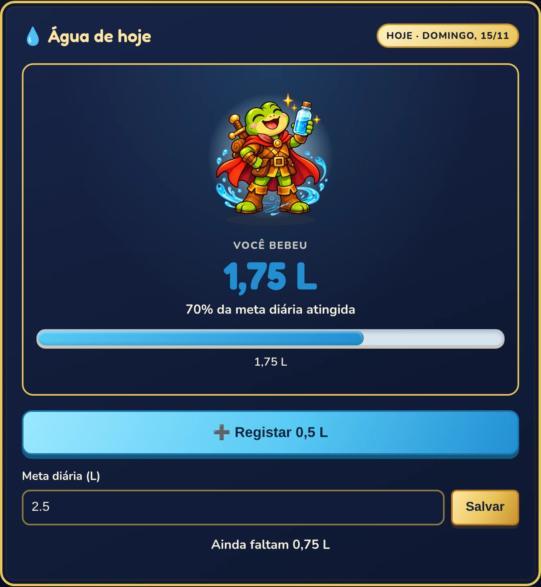
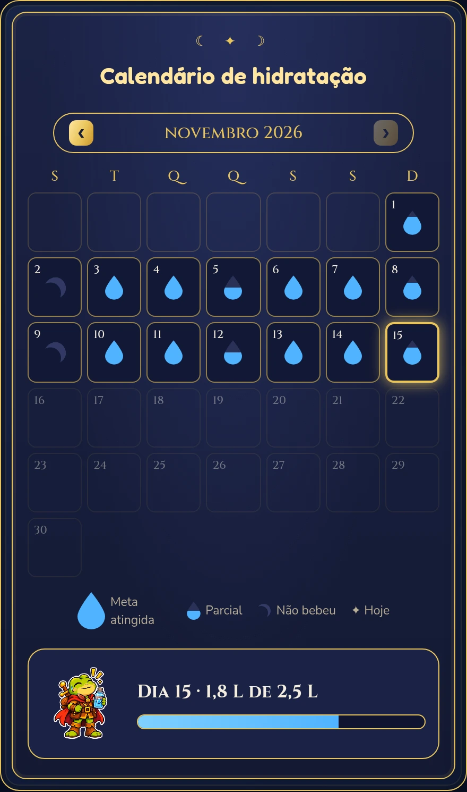
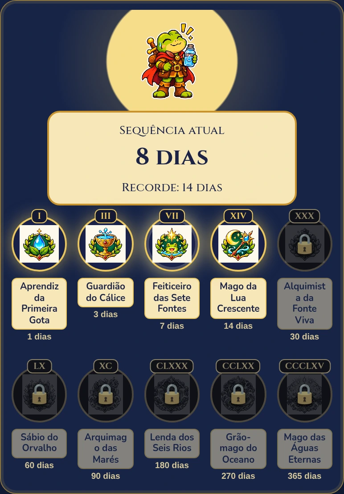
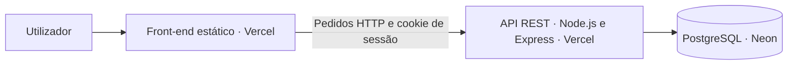

# 🐸 WaterKraft

**WaterKraft** é uma aplicação web para acompanhar a hidratação: o utilizador regista o consumo de água, define uma meta diária e acompanha o progresso com um calendário, estatísticas, selos e um tarot temático.

[Aplicação publicada](https://waterkraft-frontend.vercel.app/) · [API](https://healthy-track-one.vercel.app/api) · [Quadro Trello](https://trello.com/b/zGNzTZfd/healthytrack-projeto-final)

## Capturas de ecrã

As imagens abaixo mostram o painel de hidratação, o calendário e os selos. São capturas com dados fictícios.

<p align="center">
  
  
  
</p>

## Funcionalidades

### Hidratação e progresso

- Registo e consulta do histórico de consumo de água.
- Meta diária personalizável e avaliação inicial.
- Estatísticas dos últimos sete dias e calendário mensal de hidratação.
- Perfil com sequência de dias, recordes e selos de progresso.
- Tarot da Hidratação com tiragem de três cartas, significados e cartas invertidas.

### Conta e segurança

- Registo, início e término de sessão.
- Palavras-passe guardadas com hash bcrypt.
- Sessões autenticadas por cookie `HttpOnly`, persistidas na base de dados e revogadas no logout.
- Registos de água isolados por utilizador autenticado.
- Cabeçalhos de segurança, validação da origem dos pedidos e limitação de tentativas de login por IP e conta.

### Desafios e perfis

- Perfis de utilizador e gestor de desafios.
- Gestores podem criar, editar e apagar os seus próprios desafios.
- Utilizadores podem participar em vários desafios e sair quando quiserem.
- Participações guardadas numa tabela de ligação, com prevenção de duplicados.
- Plaqueta de participação atribuída ao inscrever-se e medalha rara opcional, avaliada pelo gestor após sete dias consecutivos a cumprir a meta diária.
- Coleção de emblemas no dashboard: a plaqueta aparece após a primeira participação e as medalhas raras após aprovação do gestor.
- [Diagrama entidade-relacionamento](docs/diagrama-er.md).

### Manutenção

- Limpeza diária de contadores de tentativas de login inativos há mais de 24 horas, com registo de execuções e erros no log. A tarefa não altera contas nem registos de hidratação.

## Arquitetura



- **Front-end:** HTML, CSS e JavaScript responsivos, publicados como site estático na Vercel. O rewrite de `/api` está definido em [`frontend/vercel.json`](frontend/vercel.json).
- **Back-end:** API REST Node.js e Express, publicada na Vercel.
- **Base de dados:** PostgreSQL na Neon em produção; PostgreSQL local no Docker Compose.
- **Migrações:** esquema versionado com `node-pg-migrate`.

## Estrutura do repositório

```text
healthy-track/
├── .github/workflows/    # CI e verificação/migração da base de dados
├── backend/
│   ├── db/migrations/    # Migrações e seed local
│   ├── server.js         # API REST
│   ├── server.test.js    # Testes da API
│   └── API.md            # Referência da API
├── docs/
│   └── diagrama-er.md    # Diagrama entidade-relacionamento
├── frontend/             # Interface web, capturas e testes
│   └── vercel.json       # Rewrite das rotas /api
├── docker-compose.yml    # Ambiente local com front-end, API e PostgreSQL
└── README.md
```

## Executar localmente

### Requisitos

- Docker Desktop com Docker Compose.
- Git, para clonar o repositório.

### Iniciar

1. Cria um ficheiro `.env` na raiz do projeto com valores locais:

   ```env
   DB_PASSWORD=escolhe-uma-palavra-passe-local
   JWT_SECRET=define-um-segredo-aleatorio-e-longo
   ```

2. Na raiz do repositório, inicia os serviços:

   ```bash
   docker compose up --build
   ```

3. Abre a aplicação em [http://localhost:8080](http://localhost:8080). A API fica disponível em [http://localhost:3000/api](http://localhost:3000/api).

O seed local cria contas fictícias e dados de demonstração apenas quando a base de dados está vazia. Se já houver utilizadores, preserva os dados existentes.

**Conta de demonstração local**

- Email: `demo@waterkraft.local`
- Palavra-passe: `WaterkraftDemo2026!`

**Gestor de desafios local**

- Email: `gestor@waterkraft.local`
- Palavra-passe: `WaterkraftGestor2026!`

Estas contas são apenas para desenvolvimento local; o seed está desativado na produção. Para promover uma conta já registada, executa `cd backend && npm run promover-gestor -- email@exemplo.com` com acesso autorizado à base de dados.

Para parar os serviços, usa `Ctrl+C`. Para os remover, executa `docker compose down`. Os dados da base de dados ficam no volume Docker `postgres_data`.

## Testes e qualidade

Executa os testes do back-end e o lint a partir da pasta `backend`:

```bash
cd backend
npm ci
npm test
npm run lint
```

Executa os testes do front-end a partir da raiz:

```bash
npm --prefix frontend test
```

A última verificação local registada passou com **102 testes do back-end** e **4 testes do front-end**. O lint terminou sem erros; apresentou dois avisos já existentes numa migração. O workflow de GitHub Actions executa testes do back-end, lint e testes do front-end.

## Deploy

A aplicação está publicada na Vercel:

- Front-end: [waterkraft-frontend.vercel.app](https://waterkraft-frontend.vercel.app/)
- API: [healthy-track-one.vercel.app/api](https://healthy-track-one.vercel.app/api)
- Base de dados PostgreSQL: Neon.

O front-end encaminha as chamadas `/api` para a API publicada. As migrações pendentes devem ser aplicadas à base de dados de produção com `npm run migrate:up`, usando `DATABASE_URL` configurada apenas no ambiente local seguro. Nunca publiques a URL de conexão.

Antes de utilizar os emblemas de desafios em produção, aplica também a migração `1794400000000_add-emblemas-desafios` à Neon Production. A migração cria os campos de configuração e avaliação e a tabela dos emblemas; não apaga registos de hidratação nem contas.

## Estado da entrega

Foram verificados na aplicação publicada o registo com uma conta fictícia, login, registos de hidratação, desafios com os perfis de utilizador e gestor, logout e término da sessão. Os critérios de aceitação e o estado das tarefas estão no [quadro Trello — HealthyTrack](https://trello.com/b/zGNzTZfd/healthytrack-projeto-final).

Usa apenas dados fictícios. Não introduzas dados pessoais reais na aplicação ou nos dados de demonstração.
