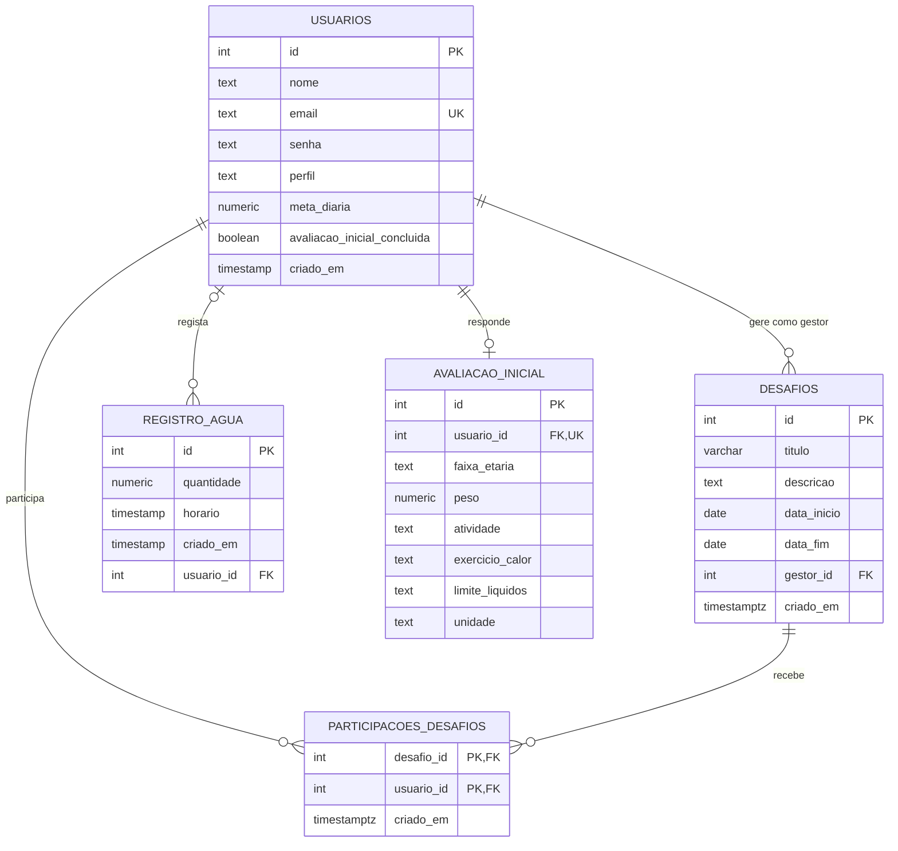

# Diagrama entidade-relacionamento

O diagrama representa o esquema PostgreSQL atual do HealthyTrack. A tabela `participacoes_desafios` resolve a relação muitos-para-muitos entre utilizadores e desafios: cada linha associa um utilizador a um desafio.

`PARTICIPACOES_DESAFIOS` tem uma chave primária composta por `(desafio_id, usuario_id)`. Assim, a base de dados impede que o mesmo utilizador participe duas vezes no mesmo desafio. As duas chaves estrangeiras usam eliminação em cascata: apagar o utilizador ou o desafio também remove as respetivas participações.

As relações `USUARIOS`–`PARTICIPACOES_DESAFIOS` e `DESAFIOS`–`PARTICIPACOES_DESAFIOS` são individualmente um-para-muitos; em conjunto, representam a relação muitos-para-muitos entre utilizadores e desafios.
